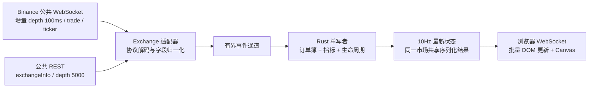

# μScope · 微观市场监控

基于 Rust 的 Binance 现货微观结构监控网站。使用真正的 L2 增量深度、原始逐笔成交和 24h ticker，在后端计算项目文档定义的八项指标，通过 WebSocket 实时展示。没有模拟行情，也不需要 API Key。

## 启动

```sh
cargo run --release
```

打开 **http://127.0.0.1:3000**。在输入框填写任意 Binance 正在交易的现货 Symbol，例如 `BTCUSDT`、`ETHUSDT`、`ETHBTC`、`SOLUSDT`；也接受 `BTC/USDT`。程序会读取交易所的交易对列表、基础币、报价币和价格精度，而不是把单位固定为 BTC/USDT。

需要 Rust 1.88+（edition 2024、let chains）。本次使用 Rust 1.94.1 验证。浏览器需支持 WebSocket、Canvas、ResizeObserver、HTML dialog；推荐现代 Chrome/Edge/Firefox/Safari。Node.js 22+ 仅用于运行验证脚本，运行网站不需要 Node、npm 或前端构建。

前端 HTML/CSS/JavaScript 内嵌在 Rust 可执行文件中；修改前端后需要重新运行 `cargo run --release` 并刷新页面。

## 已实现

- **全部八项指标**：Pressure、1/5 bp 近价深度、Trade Delta、Absorption、Replenishment、Defense Heat、Rotation、Volatility Expansion。
- 中间价与压力时间序列、0–20 bp 累计深度曲线、主动买卖成交额、两侧各 20 档订单簿、最近 60 笔成交、价位防守表、压力相图。
- 同时计算完整的 1s/5s/10s 成交窗口；页面上的成交条数上限不会截短计算窗口。
- 吸收／重复补量事件、事件确认后 1s/5s/15s 的价格反应；原始明细与最大不利价格变化可随快照导出。
- 任意有效现货 Symbol、快捷交易对、统计窗口选择、1/3/15 分钟曲线、鼠标读数、暂停观察、JSON 导出、逐项公式说明。
- 深度序号、源时间差、接收年龄、覆盖范围、成交缺口、无法匹配到盘口的成交数量、计算与绘制耗时。
- 手机与桌面布局。页面会话历史最多保留 9,000 个采样点，约 15 分钟。
- 可选的[数据录制](docs/recording.md)：常驻记录指标引擎的全部输入，每小时生成一个压缩文件，可离线回放，逐帧复现线上指标，用于回测与机器学习。

## 实时架构



每个 `venue + spot + symbol` 只有一个数据接入和计算任务。最多同时订阅 8 个市场；同一市场的多个页面共享计算结果。没有订阅者 15 秒后释放上游连接。慢浏览器跳过过期展示帧，直接获得最新状态，原始行情计算不因展示节流而丢弃。

指标计算在 Rust 完成。JavaScript 使用 `requestAnimationFrame` 合并更新，盘口复用固定节点，曲线使用 Canvas，数字与时间格式器复用，绘图按像素保留极值，隐藏页面暂停绘图。当前规模不需要 WebAssembly。可复现验证及测量边界见 [验证记录](docs/verification.md)。

## 计算口径和有效性

依据 [核心微观结构指标与计算方法](核心微观结构指标与计算方法.md)，细节见 [实现与接口](docs/architecture.md)。

- 先建立 WebSocket 并缓冲，再取得 REST 快照；忽略旧增量，通过 `U <= local_id + 1 <= u` 衔接；任何后续缺口都会丢弃旧状态、重新同步。
- 价格使用 `10⁸` 定点整数作为价位键；基础币数量、金额与指标使用 `f64`。当前支持价格精度不超过 8 位的小数。
- 近价深度使用 `基础币数量 × 中间价`。只在初始完整快照边界内维护可信盘口；边界外的零散更新不会扩展完整覆盖的声明。
- 接收年龄超过 3s、源时间差超过 5s、源时间领先本机超过 2s、缺失／交叉盘口、序号缺口时，输出缺失或明确失效状态。电脑应保持时钟同步；源时间差不是网络 RTT。
- 成交按 ID 去重；ID 缺口会清空成交窗口并重新预热。时间倒退会触发重建。没有成交时比例和 Delta 为 `null`，预热期间金额为已观察到的部分量。
- `m=true` 映射为主动卖出。补量是增量深度之间**可观察的净增加**，不是实际全部新增委托量。
- 吸收阈值固定为 0.70、攻击窗口 3s；确认必须有覆盖最新攻击时间的深度更新，且价位依然存在。事件不证明隐藏订单或持续守住。
- 深度与逐笔成交并非撮合引擎的统一事件日志。最近可见量若来自成交之后，则不用于该次攻击匹配；这笔成交仍完整计入 Delta，并计入未匹配统计。
- 后续收益为确认后的原始中间价收益，到达期限才填充；超过目标 500ms 的采样不会冒充该期限的结果。深度中断超过 3s 会清空未完成事件和相空间状态。
- 页面历史和事件属于当前进程／订阅会话，不持久化数据库。重连或进程重启会重新预热；刷新页面会重新积累曲线。需要保留研究数据时，开启数据录制。

## 配置

| 环境变量 | 默认值 | 用途 |
|---|---|---|
| `BIND_ADDR` | `127.0.0.1:3000` | HTTP 和网页 WebSocket 监听地址 |
| `BINANCE_REST_URL` | `https://data-api.binance.vision` | 公共行情 REST 基地址 |
| `BINANCE_WS_URL` | `wss://data-stream.binance.vision` | 公共行情 WebSocket 基地址 |
| `RUST_LOG` | `micro_btc_index=info` | 日志等级 |
| `RECORD_SYMBOLS` | 空 | 要常驻录制的交易对，逗号分隔，例如 `BTCUSDT,ETHUSDT`；为空时不录制 |
| `RECORD_DIR` | `data/raw` | 录制文件根目录 |

例如更换本地端口：

```sh
BIND_ADDR=127.0.0.1:8088 cargo run --release
```

默认仅本机访问。如需部署到远程服务器，请在反向代理中配置 HTTPS/WSS、访问控制及资源限制；WebSocket 默认检查同源 Origin，代理应保留正确的 Host。程序不使用交易权限，也不包含下单接口。

连续 3 次建立连接或同步失败后，页面显示错误并停止该轮重试。先检查监听地址、公共 REST、公共 WS 和网络条件，再点击“重新连接”。稳定运行超过 60 秒后，连续失败计数重新开始。

## 数据录制

```sh
RECORD_SYMBOLS=BTCUSDT,ETHUSDT cargo run --release
```

录制的交易对不依赖页面，一直保持连接，断线后持续重连。文件按 `data/raw/<交易所>/spot/<交易对>/<UTC 日期>/<HHMMSS>.jsonl.zst` 每小时生成一个。录制不会阻塞行情计算；丢失的输入会在文件中记为 `gap`，`/api/health` 中也会显示。行格式、回放规则、读取方法和磁盘用量见 [数据录制](docs/recording.md)。

## 验证

```sh
cargo test
cargo clippy --all-targets -- -D warnings
node --check web/app.js
cargo build --release

# 独立本地协议故障测试；自行启动并清理临时监听器和测试进程
node scripts/reconnect-test.mjs

# 先启动网站，再检查真实公共行情、多交易对和共享订阅
node scripts/live-smoke.mjs
```

浏览器控制台：

```js
microScope.stats();          // 当前快照、推送数、绘制耗时、DOM/历史点数量
await microScope.benchmark(180); // 重复真实样本至 9,000 点，在 rAF 中运行 180 帧
```

压测会显示明确提示；重复样本只用于渲染压力测试。p95 包含 JS DOM 更新与 Canvas 绘制命令提交，不包含 GPU 合成，也不是完整端到端延迟。

## 扩展交易所

实现 [`Exchange`](src/exchange/mod.rs)，返回 `SymbolInfo`、`BookSnapshot` 与 `MarketEvent`，再注册到 [`Hub.exchanges`](src/main.rs)。适配器需要把该交易所的更新规则转换为标准的连续版本区间，并正确统一主动方方向与数量单位。网页交易所列表来自 `/api/venues`。初期注册 Binance；不显示尚未实现的交易所选项。

官方协议参考：[Binance WebSocket Streams](https://developers.binance.com/docs/binance-spot-api-docs/web-socket-streams)、[Binance Market REST](https://developers.binance.com/docs/binance-spot-api-docs/rest-api/market-data-endpoints)。
